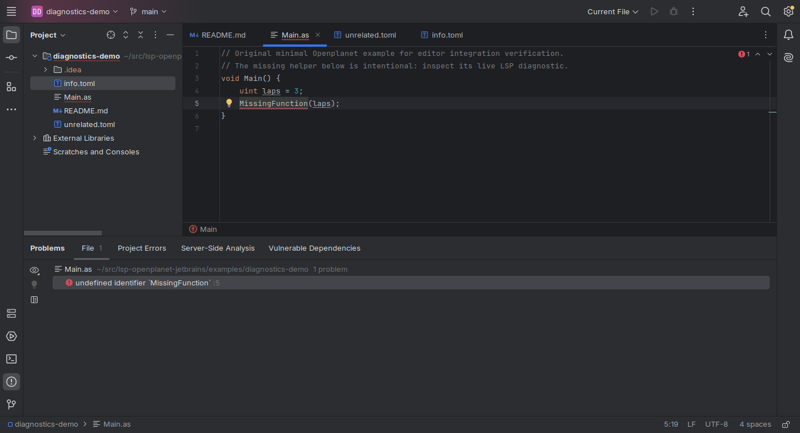

# Openplanet for JetBrains

Free AngelScript language support for IntelliJ IDEA Community 2024.3.x, powered by LSP4IJ and openplanet-lsp. No Ultimate LSP license is required.

[Install, configure and troubleshoot](https://github.com/clankercode/lsp-openplanet-jetbrains#readme) · [Download plugin](https://github.com/clankercode/lsp-openplanet-jetbrains/releases)

[Verification](verification) · [API compatibility research](api-research) · [Marketplace publishing](publishing)

The plugin associates `.as` files and sends only `info.toml` manifests to the server while preserving TOML syntax support. The language server is installed separately; paths and explicit initialization options are configured under Settings → Languages & Frameworks → Openplanet.

